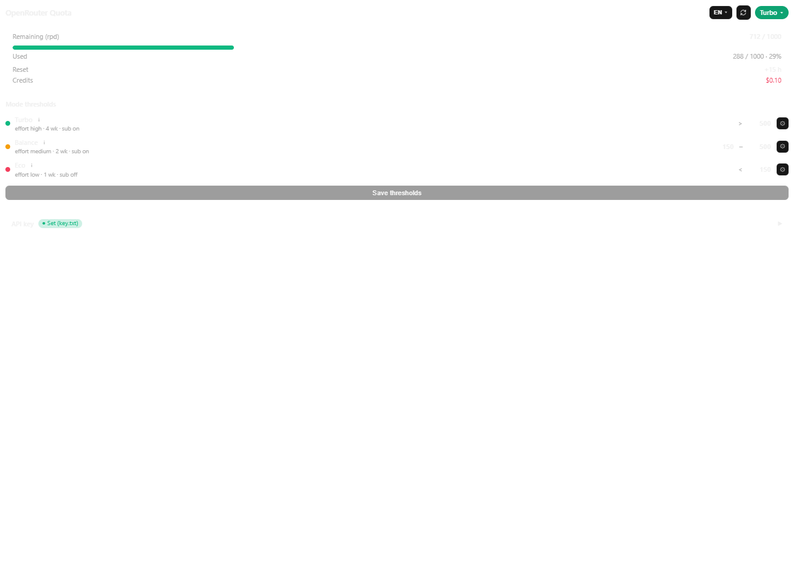

# Quota Panel

English | [Русский](README.ru.md) | [简体中文](README.zh.md)

A right-sidebar panel for [Orca](https://orca.com) that keeps an eye on your free
[OpenRouter](https://openrouter.ai) daily request limit so you don't burn it too early.



## What it does

- **Remaining requests (rpd)** — shows `remaining / limit` for the current UTC day, with a
  progress bar and the time until the daily reset (shown in **your local time**, no hard-coded
  timezone).
- **Three modes** — **Turbo**, **Balance** and **Eco**, plus **Auto** which picks a mode from the
  thresholds. The active mode is computed from the remaining requests (or the manual mode you pick).
- **Editable thresholds** — set the Turbo (`>`) and Eco (`<`) boundaries; the Balance range
  (`min – max`) is editable too and stays in sync with them. Validation forbids `min >= max`.
- **Per-mode hints** — each mode stores an *effort / workers / subagents* preset. These are kept as
  metadata for agents and skills to read; the plugin does **not** switch models or agents itself —
  the actual effort, model and worker count are chosen by the agent at launch.
- **API key** — paste your OpenRouter key in the panel, or drop it in the skill's `key.txt`. The key
  is always masked in the UI.
- **Three languages** — English, Russian and Chinese, auto-detected from your locale with a one-click
  switcher in the header (your choice is remembered).

## Install

In Orca: **Settings → Plugins → Add Plugin → From Git URL**, then paste this repository's URL:

```
https://github.com/sleet1k/orca-quota-panel.git
```

Orca asks for approval the first time (the plugin runs a small worker and stores its own data), then
the **Quota Panel** appears in the right sidebar.

## Data & privacy

- The API key is stored in the plugin's own storage (or read from `key.txt`) and is **never**
  committed or shown in full.
- Thresholds, per-mode hints and the language choice live in the plugin's storage and survive
  restarts.

## Develop

```sh
orca plugin validate .        # validate the manifest and assets
orca plugin check .           # render the panel once per scenario
orca plugin dev watch .       # load this folder into Orca with live reload (Ctrl-C unloads)
```

The panel is a single `src/panel.html` (HTML/CSS/JS, no build step). The worker is `src/worker.ts`;
`src/protocol.ts` types the request contract between them. Orca transpiles the worker on load.

## License

[MIT](LICENSE).