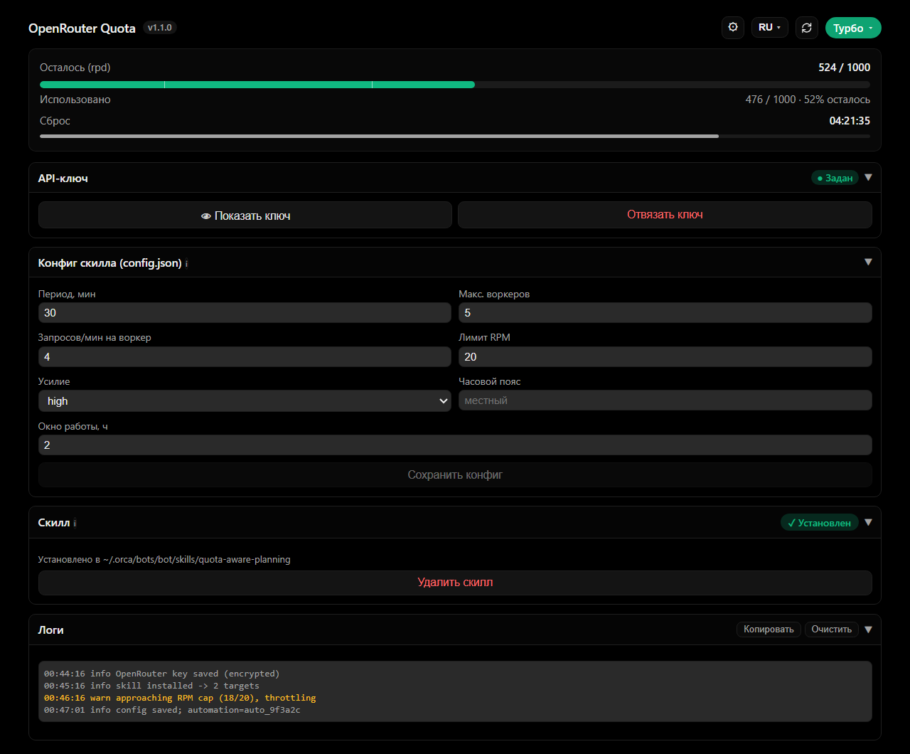

# Quota Panel

[English](README.md) | Русский | [简体中文](README.zh.md)

Боковая панель для [Orca](https://orca.com), которая следит за бесплатным дневным лимитом запросов
[OpenRouter](https://openrouter.ai), чтобы вы не сожгли его слишком рано.



## Что умеет

- **Остаток запросов (rpd)** — показывает `remaining / limit` на текущие UTC-сутки с полосой
  прогресса остатка, отметками порогов и живым обратным отсчётом до сброса в 00:00 UTC (при
  наведении отображается время сброса в **вашем локальном часовом поясе**).
- **Три режима + Авто** — **Турбо**, **Баланс** и **Эко**, плюс **Авто**, которое выбирает режим по
  порогам остатка. В шапке также отображается бейдж текущей версии (`v1.1.0`).
- **Модалка настроек (пороги режимов)** — открывается по иконке шестерёнки в шапке для редактирования
  границ Турбо (`>`), Эко (`<`) и Баланса (`мин – макс`). Соседние границы синхронизированы без
  разрывов и проходят валидацию (`мин < макс`), а кнопки сохранения активны только при наличии
  несохранённых изменений.
- **API-ключ с просмотром по PIN** — вставьте ключ OpenRouter в сворачиваемой секции **API-ключ**
  (или используйте `key.txt`). Ключ хранится зашифрованным (AES-256-GCM, локальный ключ машины) и
  остаётся скрытым до ввода локального PIN (хранится только SHA-256 хеш), с копированием в один клик
  и автоскрытием через 30 секунд или при сворачивании секции.
- **Конфиг скилла (`config.json`)** — компактная сетка 2×2 (`cronMinutes`, `maxWorkers`,
  `perWorkerRpm`, `rpmCap`), а также `defaultEffort`, `timezone` и `workWindowHours` с мгновенными
  подсказками. Сохранение создаёт или обновляет автоматизацию Orca (`Quota review`) через Orca CLI.
- **Встроенный скилл `quota-aware-planning`** — установка в один клик во всех ботов Orca
  (`~/.orca/bots/*/skills`) и глобальное зеркало OpenCode (с сохранением пользовательских конфига,
  ключа и режима), бейдж `Установлен` и удаление в один клик.
- **Логи** — сворачиваемый журнал с сохранением между перезапусками, цветовой подсветкой уровней
  (`info` / `warn` / `error`), кнопками «Копировать» и «Очистить» и автопрокруткой.
- **Три языка** — английский, русский и китайский, с автоопределением по локали и компактным
  выпадающим переключателем в шапке (выбор запоминается).

## Установка

В Orca: **Настройки → Плагины → Добавить плагин → По Git URL**, затем вставьте URL репозитория:

```
https://github.com/sleet1k/orca-quota-panel.git
```

При первом запуске Orca запросит подтверждение (плагин запускает небольшой worker и хранит свои
данные), после чего **Quota Panel** появится в правой боковой панели.

## Данные и приватность

- API-ключ шифруется при хранении (AES-256-GCM с локальным ключом машины) в собственном хранилище
  плагина, экспортируется в `key.txt` для bash-скилла и **никогда** не попадает в коммиты.
- Просмотр ключа защищён локальным PIN (хранится только SHA-256 хеш); показанный ключ доступен только
  для чтения и автоматически скрывается через 30 секунд или при сворачивании секции.
- Пороги, выбор языка, ID автоматизации и последние логи хранятся в хранилище плагина и переживают
  перезапуск.

## Разработка

```sh
orca plugin validate .        # проверить манифест и ресурсы
orca plugin check .           # отрисовать панель по одному разу на сценарий
orca plugin dev watch .       # загрузить папку в Orca с живым перезапуском (Ctrl-C выгружает)
```

Панель — это один `src/panel.html` (HTML/CSS/JS, без сборки). Worker — `src/worker.ts`;
`src/protocol.ts` типизирует контракт запросов между ними, а `skill/quota-aware-planning/` содержит
встроенный скилл. Orca транспилирует worker при загрузке.

## Журнал изменений

См. [CHANGELOG.md](CHANGELOG.md).

## Лицензия

[MIT](LICENSE).
