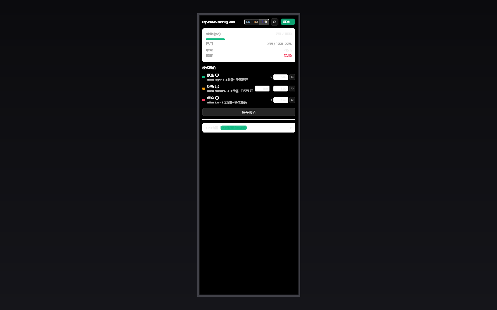

# Quota Panel

[English](README.md) | [Русский](README.ru.md) | 简体中文

用于 [Orca](https://orca.com) 的右侧边栏面板，帮你关注 [OpenRouter](https://openrouter.ai) 的每日免费请求额度，
避免过早耗尽。



## 功能

- **剩余请求数 (rpd)** — 显示当前 UTC 日的 `remaining / limit`，带进度条和距每日重置的时间
  （以**你的本地时区**显示，无硬编码时区）。
- **三种模式** — **极速**、**均衡** 和 **省流**，以及 **自动**（按阈值选择模式）。当前模式根据剩余
  请求数（或你手动选择的模式）计算。
- **可编辑阈值** — 设置极速（`>`）和省流（`<`）边界；均衡区间（`最小 – 最大`）也可编辑，并与它们
  保持同步。校验禁止 `最小 >= 最大`。
- **按模式提示** — 每个模式保存一个 *effort / 工作器 / 子代理* 预设。这些作为元数据供代理与技能读取；
  插件本身**不会**切换模型或代理——实际的 effort、模型和工作器数量由代理在启动时选择。
- **API 密钥** — 在面板中粘贴你的 OpenRouter 密钥，或放入技能的 `key.txt`。密钥在界面中始终被遮蔽。
- **三种语言** — 英语、俄语和中文，按本地环境自动检测，并在顶部一键切换（会记住你的选择）。

## 安装

在 Orca 中：**设置 → 插件 → 添加插件 → 从 Git URL**，然后粘贴本仓库地址：

```
http://192.168.10.23:3000/sleet1k/orca-quota-panel.git
```

首次运行时 Orca 会请求授权（插件会运行一个小型 worker 并存储自己的数据），之后 **Quota Panel** 会
出现在右侧边栏。

## 数据与隐私

- API 密钥存储在插件自己的存储中（或从 `key.txt` 读取），**绝不**提交或完整显示。
- 阈值、按模式提示和语言选择保存在插件存储中，重启后仍然保留。

## 开发

```sh
orca plugin validate .        # 校验清单与资源
orca plugin check .           # 每个场景渲染一次面板
orca plugin dev watch .       # 将文件夹加载到 Orca 并实时重载（Ctrl-C 卸载）
```

面板是单个 `src/panel.html`（HTML/CSS/JS，无需构建）。worker 是 `src/worker.ts`；
`src/protocol.ts` 定义两者之间的请求契约。Orca 在加载时转译 worker。

## 许可证

[MIT](LICENSE)。